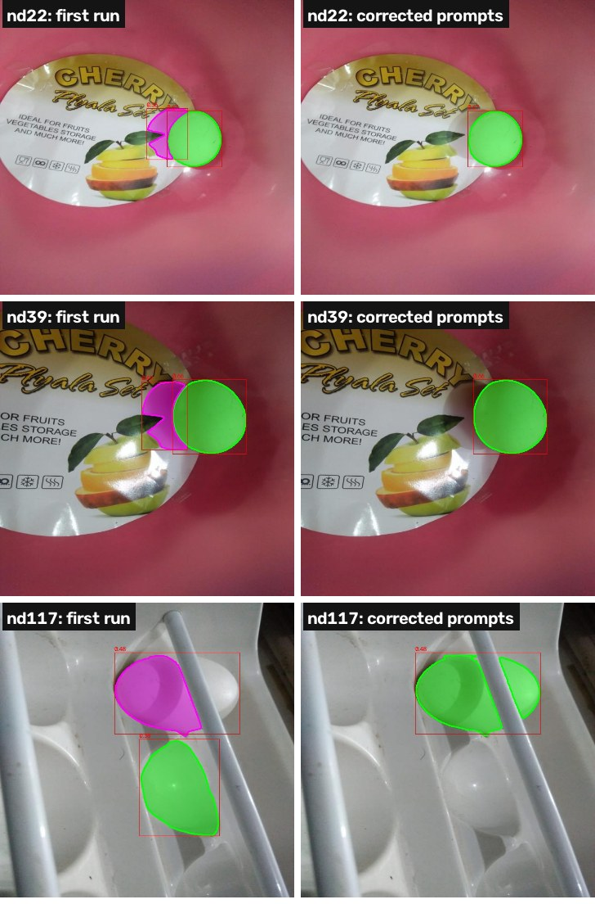
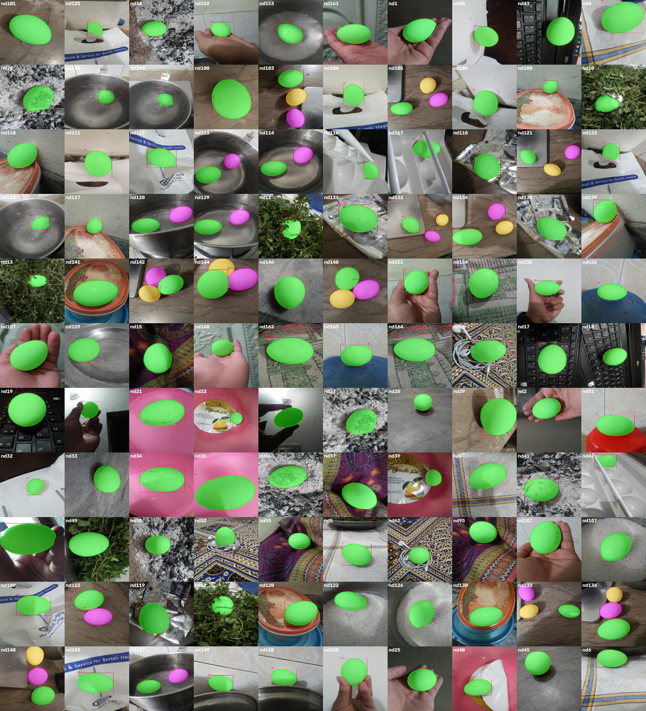

# Task 1 – Segmentation with a pretrained model

**Notebook:** `notebooks/01_task1_sam_groundtruth.ipynb` (Google Colab, T4 GPU, ~3 s per image).

## Method: Grounded-SAM

SAM (Segment Anything) is a *promptable*, class-agnostic segmenter: a ViT-H image encoder runs once per image and a
light mask decoder turns a prompt (box or points) into a mask. SAM does not know what an "egg" is, so it is paired
with **Grounding DINO**, an open-vocabulary detector that turns the text prompt `"egg."` into boxes:

`image → Grounding DINO ("egg.", box threshold 0.30, text threshold 0.25) → box filtering → SAM ViT-H (one mask per box) → clean-up`

* **Box filtering:** drop boxes covering > 90% of the image (bowl, table); non-maximum suppression at IoU 0.5
  (duplicate boxes); drop "group boxes" that contain ≥ 2 other egg boxes (a box around a cluster of eggs).
* **SAM:** one box prompt per egg, `multimask_output=False` (a box is an unambiguous prompt).
* **Clean-up:** keep the largest connected component and fill holes (specular highlights can punch holes);
  overlaps between eggs resolved by painting larger masks first.
* **Outputs:** binary masks (ground truth for Tasks 2–3), instance masks (egg IDs), overlays, `detections.json`
  (boxes, scores, SAM predicted IoU, settings).

## Visual quality control

All 110 overlays were inspected. 107 were correct as produced, including eggs partly hidden by leaves, a paper flap
or a rod, eggs in water and on white tapioca pearls. Three were wrong and were fixed **with better SAM prompts, not by
hand-painting**, so the ground truth stays model-generated and reproducible (overrides are logged in `detections.json`):

| image | problem in the first run | fix |
|---|---|---|
| nd22, nd39 | 2nd box (score 0.36 / 0.49) = the egg's shadow on a printed lid | keep only the top-scoring box |
| nd117 | lower box (0.38) = an empty egg-shaped tray cup; a rod splits the real egg, SAM masked one half and the largest-component clean-up dropped the rest | keep top box, add positive points on both halves and a negative point on the rod, keep all large components |

All three false boxes scored below 0.5, and the two lowest-scoring boxes of the whole dataset (0.36, 0.38) were
false: detector confidence is a useful pointer to images that need checking, but not a safe automatic filter
(several true eggs scored 0.41–0.49).

## Result

138 eggs in 110 images: 93 images with 1 egg, 6 with 2, 11 with 3. SAM's own predicted IoU for its masks:
median 0.985, minimum 0.905. Median egg area: 12% of the image.

**Caveat:** these masks are *pseudo* ground truth. They are very good but not perfect (e.g. boundaries under fingers
or leaves), which caps the agreement measurable in Task 3.

