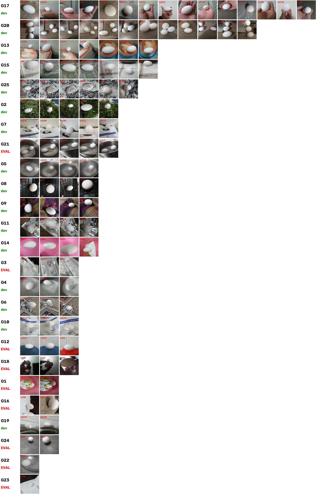
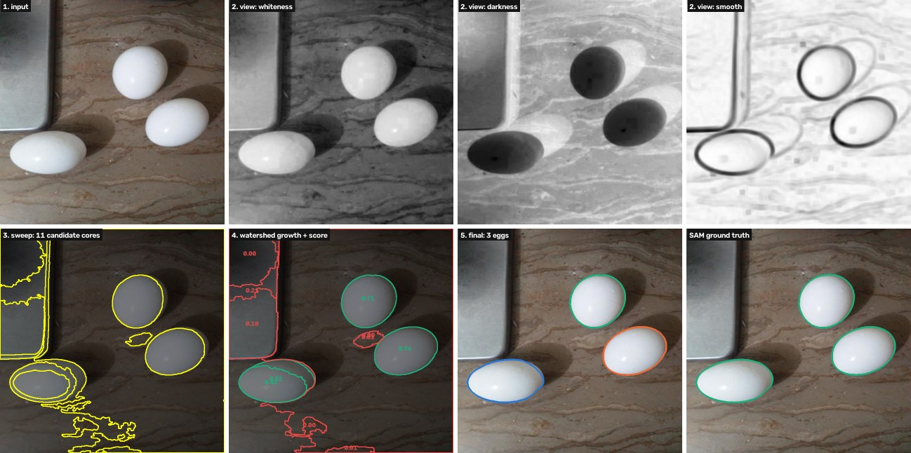
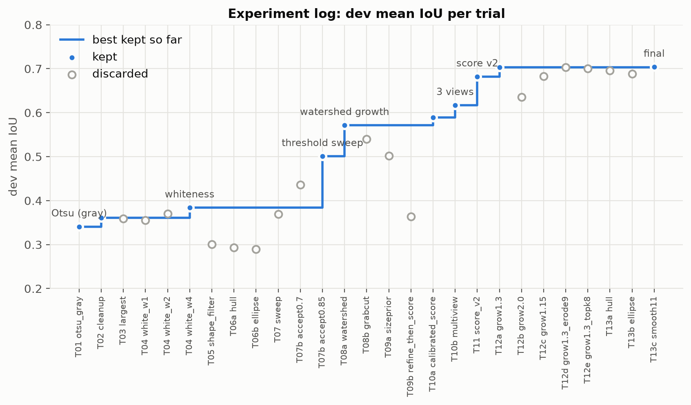

# Task 2 – Segmentation with classical image processing

## 2.1 Leakage-aware dev / eval split (4:1)

The dataset has no augmented copies (all 110 source names unique), but many photos show **the same scene**
(same table, bowl, hand or eggs). If near-duplicates land on both sides, tuning on dev "sees" eval and the eval score
is optimistic. The split is therefore made by **scene group**, not by image (`scripts/make_split.py`):

1. **DINOv2 embedding** per image (computed in the Task 1 notebook); cosine similarity = scene similarity.
2. **Agglomerative clustering** (average linkage) at similarity 0.70. Thresholds 0.60–0.85 were compared:
   0.85 leaves related scenes apart (leakage), 0.60 produces one 50-image group (4:1 impossible).
3. **Manual review** of every group: 5 same-scene pairs that the clustering missed were merged (documented in the
   script). Result: 25 scene groups.
4. **Whole groups assigned to eval**: among 5000 random assignments, choose the one with exactly 22 eval images,
   similar multi-egg share and the most eval groups.

| | random image split | **group split (used)** |
|---|---|---|
| mean similarity of an eval image to its closest dev image | 0.85 | **0.65** |
| eval images with a near-twin (> 0.9) in dev | 28% | **0%** |

**Result:** 88 dev / 22 eval images, 9 scene groups in eval (egg tray, printed lid, white sheet, dark-room hand,
steel bowl with 2 eggs, ...). All development used dev only; eval was run once with the frozen algorithm.

## 2.2 Data analysis before designing the algorithm

Using the SAM masks on dev, each colour channel was scored by ROC-AUC = probability that a random egg pixel has a
higher value than a random background pixel (`scripts/channel_analysis.py`):

| channel | per-image AUC (median) | global AUC | egg is |
|---|---|---|---|
| B, R, gray, L, V | 0.885–0.890 | 0.83–0.85 | brighter |
| S (saturation) | 0.819 | 0.77 | less saturated |
| Lab b, chroma | 0.77–0.82 | 0.65–0.71 | less colourful |
| H, Lab a | 0.71–0.75 | 0.50–0.51 | – |

Conclusions: (1) eggs are "the bright, colourless thing", (2) no channel separates them alone, so shape knowledge is
needed, (3) per-image thresholds beat one global threshold (0.89 vs 0.85), (4) the worst images (pink tub, white
sheet, steel, foil, ash) predicted the later failure modes.

## 2.3 Final algorithm (`src/eggseg/classical.py`, parameters `configs/final_classical.json`)

1. **Three feature maps ("views")**, each blurred (Gaussian 5×5):
   *whiteness* = Lab L − 4·chroma (bright and colourless); *darkness* = inverted whiteness (an egg on white paper is
   slightly greyer); *smoothness* = inverted local standard deviation (15×15) – the shell is untextured.
2. **Threshold sweep:** each view is thresholded at 24 levels between its 5th and 99.5th percentile; after a 5×5
   opening, every connected blob (0.3%–60% of the image) at every level is a candidate. Candidates are scored by
   ellipse-fit IoU × solidity × contrast to a 7-px ring, and the top 5 distinct ones per view are kept (mask NMS).
3. **Watershed growth:** each candidate core is grown by **marker-controlled watershed** on the Lab colour gradient.
   Markers: the eroded core (egg) and everything outside 1.3 × the core's fitted ellipse (background). The egg
   interior is smooth, so the flood passes the shadowed side and stops at the real outline.
4. **Egg-likeness score** of each grown region (product of terms in [0, 1]):
   ellipse-fit IoU⁴ × solidity × size prior (log-normal, fit on dev eggs) × edge strength (outline gradient vs. a ring
   just outside) × sigmoid(brightness contrast to surroundings) × 0.5 if touching the image border.
5. **Selection:** best region always kept; further eggs if score ≥ 0.25 and overlap ≤ 20%. With several eggs, a
   **joint watershed** from all chosen cores splits touching eggs along their contact line.
6. **Smoothing:** opening + closing (11 px) of each egg mask.

## 2.4 How the experiments led to the algorithm

Every trial was run with `scripts/run_experiment.py`, which scores all 88 dev images against SAM and logs parameters
and metrics to `experiments/log.csv` (each trial is reproducible from its logged parameters).

The path in short:

* **T01–T04 (0.34 → 0.38):** a single global threshold on brightness or "whiteness" always merges the egg with
  bright background (hand, carpet, paper).
* **T05–T06 (failures, 0.29–0.30):** shape filters made it *worse* – they rejected the merged egg+background blob and
  the egg with it. Lesson: the problem is **how candidates are generated**, not how they are filtered.
* **T07 (0.50):** threshold sweep – at some level each egg separates as its own ellipse.
* **T08 (0.57):** watershed growth recovers the shadowed half (GrabCut tried, worse and slower).
* **T09 (failures):** a diagnostic (best achievable IoU among candidates vs. the chosen one) showed a saturated
  edge term instead of tuning blindly.
* **T10–T11 (0.59 → 0.68):** a table of all refined candidate regions with their IoU was used to design the score
  offline (AUC of each cue); three feature views raised the best achievable IoU from 0.68 to 0.75.
* **T12–T13 (0.70):** search-region size and smoothing; hull/ellipse completion rejected (over-fills occluded eggs).
  Further tuning gave < 0.002 – the algorithm was frozen to avoid over-fitting dev.

### Experiment log (dev split, 88 images)

{{include task2_experiment_log.md}}
