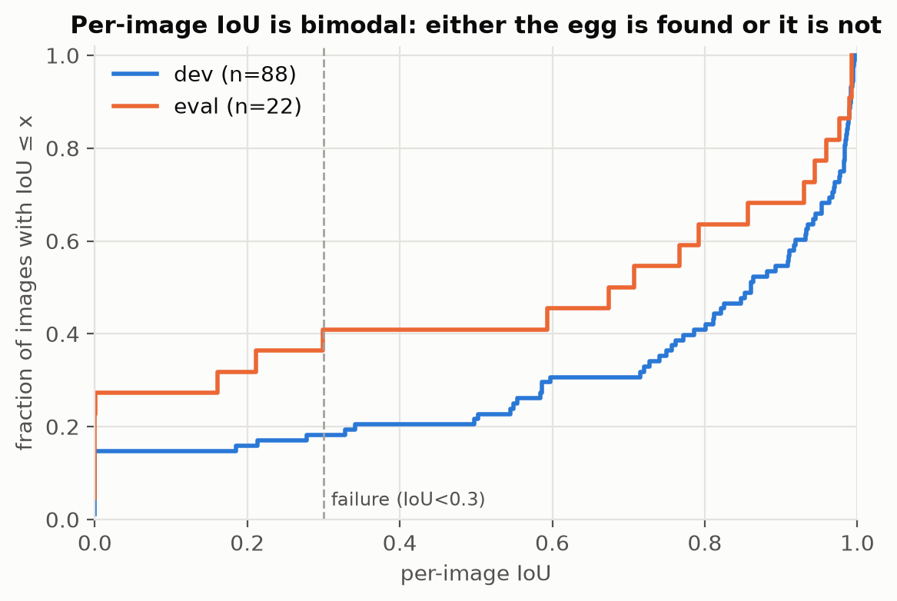
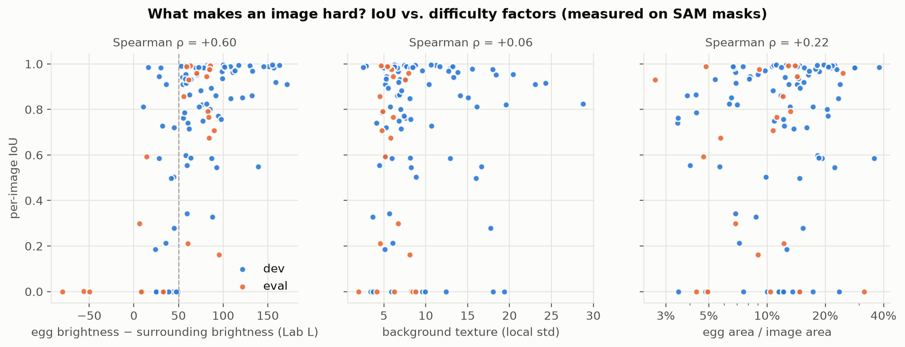
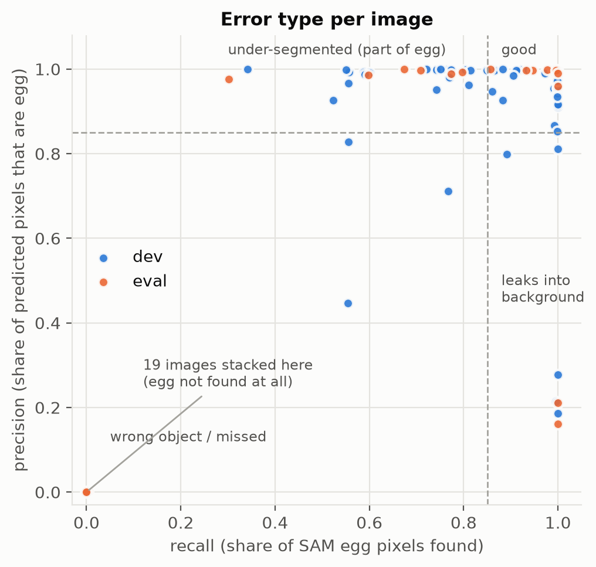
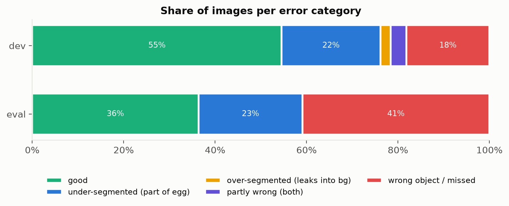
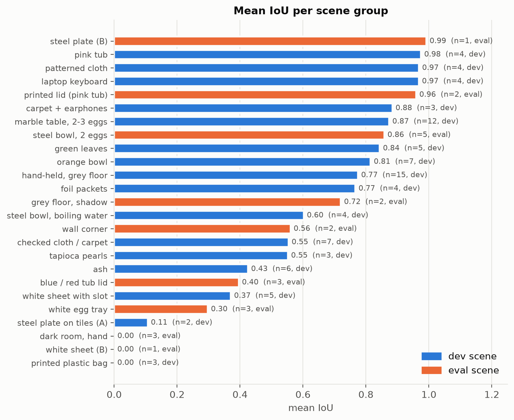
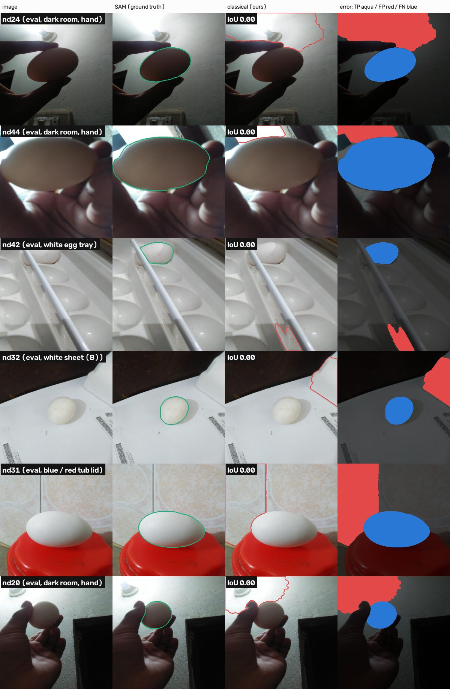
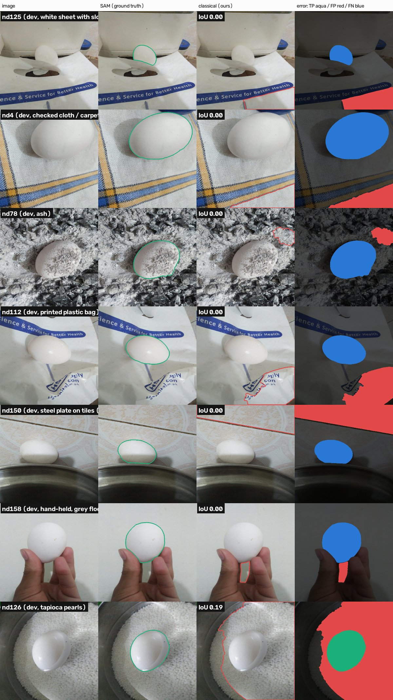
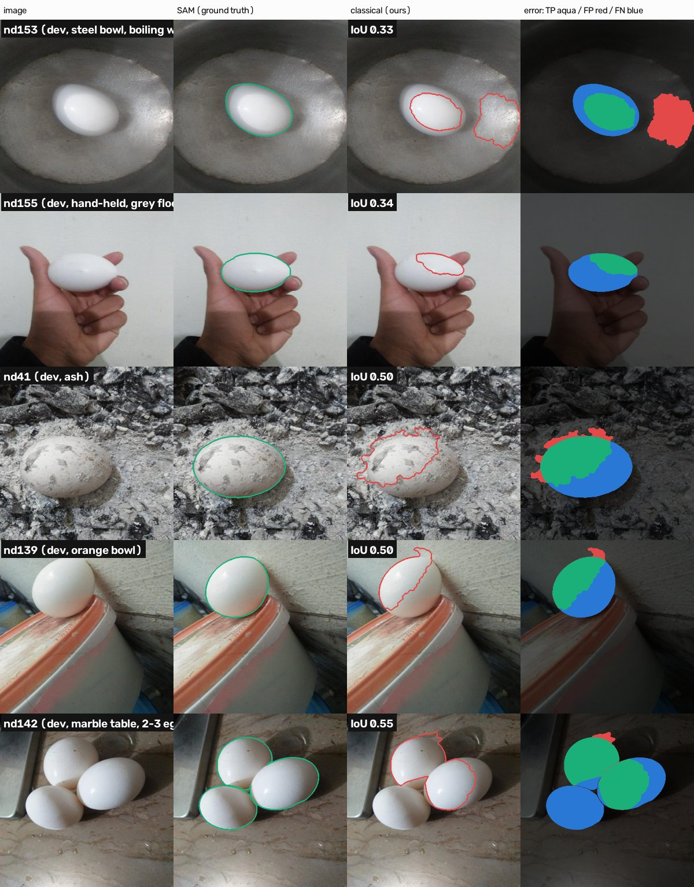
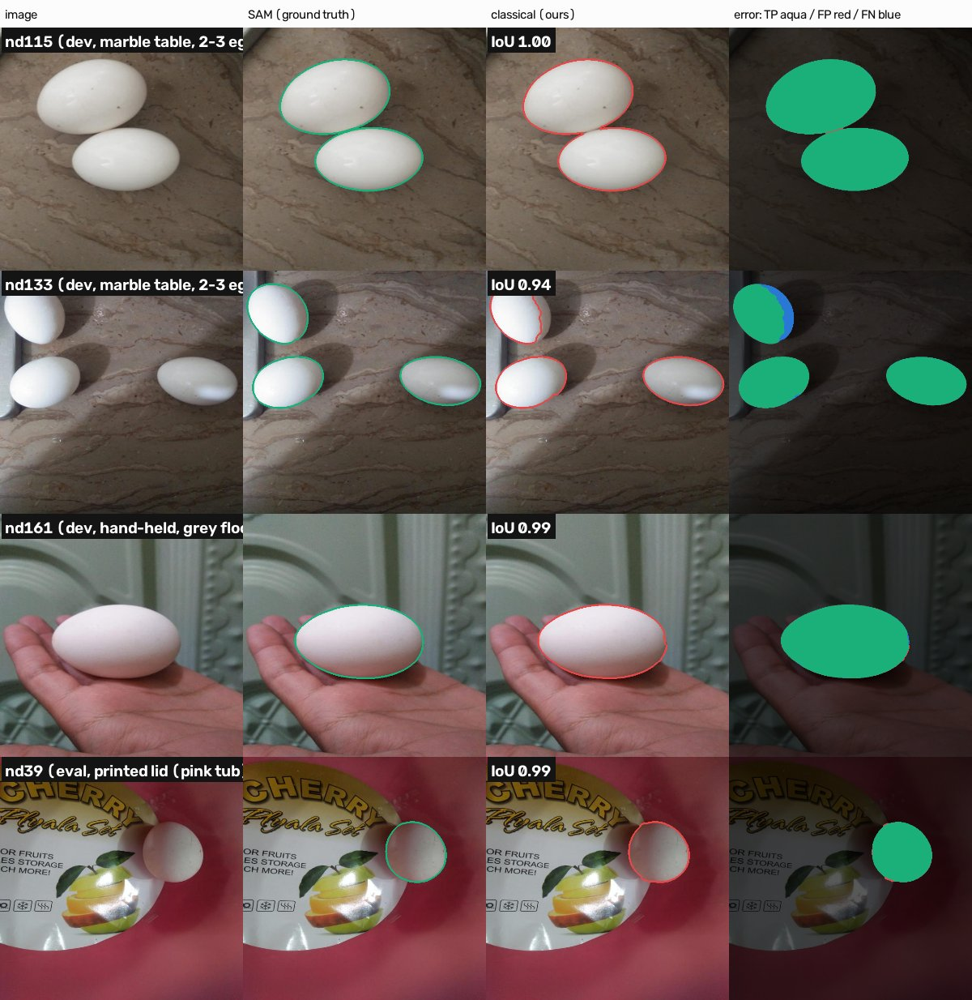

# Task 3 – Evaluation and analysis

**Setup.** Ground truth = Task 1 SAM masks (after visual QC); prediction = the frozen classical algorithm
(`configs/final_classical.json`, trial T13c). The algorithm was developed on the **dev** split only; the
**eval** split (22 images, 9 scene groups never seen during development) was run exactly once.
All numbers are reproducible with `scripts/predict_classical.py` + `scripts/task3_analysis.py`.

## 1. Metrics

| metric | what it measures | dev (88 img / 111 eggs) | eval (22 img / 27 eggs) |
|---|---|---|---|
| **mean IoU** (95% bootstrap CI) | overlap, averaged over images | **0.704** [0.63, 0.78] | **0.539** [0.36, 0.70] |
| median IoU | typical image | 0.861 | 0.691 |
| Dice | overlap (F1 of pixels) | 0.757 | 0.592 |
| pixel precision | predicted pixels that are egg | 0.794 | 0.648 |
| pixel recall | egg pixels found | 0.754 | 0.616 |
| boundary F1 (5 px) | outline accuracy | 0.590 | 0.558 |
| instance F1 (IoU ≥ 0.5) | each egg found as its own object | 0.815 | 0.630 |
| egg-count accuracy | correct number of eggs | 0.966 | 1.000 |
| images with IoU ≥ 0.7 | | 69% | 50% |
| images failed (IoU < 0.3) | | 18% | 41% |

**Why several metrics?** IoU/Dice summarise overlap but hide *how* a mask is wrong. Precision vs recall separates
"leaks into background" from "misses part of the egg". Boundary F1 checks outline quality, which IoU on a large
egg barely notices. Instance metrics and count accuracy matter for Task 4, where eggs must be tracked
individually.

**Single vs multi-egg images.** Multi-egg images are segmented *better* (IoU 0.87 dev / 0.86 eval, instance F1
0.94 / 0.90): they are the marble table and the steel bowl, both with good egg–background contrast, and the joint
watershed splits touching eggs correctly. Single-egg images carry all the hard backgrounds (IoU 0.68 / 0.44).

## 2. The main finding: the result is bimodal

`fig_iou_ecdf.png` – per-image IoU is either high or ~0. When the egg is found (72 images with IoU ≥ 0.7)
the outline is close to SAM's: **IoU 0.91, boundary F1 0.79**. The averages are pulled down by images where
**the wrong object is selected** (16 dev, 9 eval). So the main gap is **detection** (which region is the egg),
not **delineation** (where exactly its border is).

## 3. Why images fail – quantitative

* **Egg–background brightness contrast is the deciding factor** (`fig_difficulty.png`).
  Contrast = mean Lab-L inside the SAM egg − mean L in a 20 px ring around it.
  Spearman ρ(contrast, IoU) = **+0.60**. Images with contrast ≥ 50 fail in **3%** of cases (2/76);
  images with contrast < 50 fail in **68%** (23/34). Median contrast: failures 32, good images 82.
* **Background texture alone does not predict failure** (ρ = +0.06): textured carpets, keyboards and leaves work
  well when the egg is brighter than them. **Egg size** has only a weak effect (ρ = +0.22).
* **Failures are candidate failures, not scoring failures.** For each dev failure we checked the best
  region among all refined candidates (`failure_diag_dev.csv`): in **16/16** no candidate had IoU ≥ 0.5 with the
  egg. A better selection rule would not help; the egg region never forms in any of the three views.
* **Error types** (`fig_precision_recall.png`, `fig_categories.png`): good 55% dev / 36% eval; under-segmented
  (precision high, recall low) 22% / 23%; wrong object 18% / 41%; leaking into the background is rare (2%):
  the size prior and the ellipse score stop large leaks.
* **Per scene** (`fig_per_scene.png`): near-perfect on pink tub, patterned cloth, keyboard, printed lid, steel
  plate (0.96–0.99); worst on dark room (backlit), white sheets, printed plastic bag, egg tray, steel plate on tiles.
* **Dev → eval gap (0.70 → 0.54)**: 10 of the 22 eval images come from four scene types with no counterpart in dev
  (backlit dark room, white egg tray, white sheet B, red/blue tub lid). The grouped split was built to expose
  exactly this; a random split would have put near-duplicates of these scenes in dev (28% of eval images
  would have had a >0.9-similar twin in dev) and reported an optimistic number.

## 4. Why images fail – qualitative (`qual_worst_eval.jpg`, `qual_worst_dev.jpg`, `qual_partial.jpg`)

| failure mode | examples | what goes wrong |
|---|---|---|
| **Backlit egg** | nd20, nd24, nd44 (dark room) | the egg is *darker* than the lit wall/lamp behind it; every "bright & colourless" cue points at the wall, which is chosen |
| **White egg on white background** | nd32, nd42 (tray), nd106/109/112/123/125/143 (sheets, bag) | contrast ≈ 0; the egg never separates in any threshold of any view; a random paper patch, often in an image corner, is chosen instead |
| **Bright, textured background** | nd27, nd36, nd78 (ash), nd126 (tapioca) | ash on the shell gives the egg the same brightness *and* texture as the background; whiteness and smoothness views both fail |
| **Shading terminator stops the watershed** | nd155, nd139, nd153 | the lit side is found, but the edge between lit and shadowed half of the egg is stronger than the egg–background edge, so growth stops inside the egg (under-segmentation) |
| **Specular / glare highlights** | nd153, nd135, nd145 (boiling water) | the core is only the highlight; glare blobs on water are bright, round and smooth → extra false eggs |
| **Partial occlusion** | nd158 (fingers) | the visible egg part is not an ellipse → low shape score; a finger can win instead |
| **Touching eggs, 3 in a cluster** | nd142 | two eggs found and split correctly, the third (low contrast to its neighbours) is missed |

## 5. Potential improvements (ordered by expected impact)

1. **Better candidates for low-contrast scenes** – the measured bottleneck. Options: edge-based candidates
   (Canny + ellipse fitting / Hough ellipse) that do not need the egg to be brighter than the background;
   local (not global) contrast normalisation (CLAHE) before the threshold sweep.
2. **Backlight handling** – add a fourth view based on *local* rather than global brightness, or detect a
   backlit image (bright region touching the border + dark foreground) and invert the brightness prior.
3. **Shading-robust growth** – run the watershed on a gradient of the chromaticity / shading-normalised image
   (e.g. divide by a heavily blurred illumination estimate) so the lit/shadow terminator is weaker than the
   true outline; or constrain growth with an ellipse fitted to the core boundary pixels that have strong edges.
4. **Reject when unsure** – the wrong regions chosen in failures score 0.08–0.27, often below the 0.25
   acceptance threshold used for extra eggs. Applying a minimum score to the first egg as well would turn
   most wrong detections into "no egg" (same IoU, but no false positives – important for tracking).
5. **Glare suppression** – detect saturated specular blobs (V ≈ 255, tiny chroma) and inpaint/ignore them
   before computing features.
6. **Learned region scoring (still classical)** – the hand-built score is a product of 6 cues; a logistic
   regression on the same features, trained on dev with scene-grouped cross-validation, would weigh them
   optimally. Not done to keep the method fully explainable.
7. **Ground-truth caveat** – SAM masks are pseudo-labels. Visual QC fixed 3/110 images; residual SAM
   errors (e.g. egg partly hidden by leaves or a rod) set a ceiling on the measured agreement.
