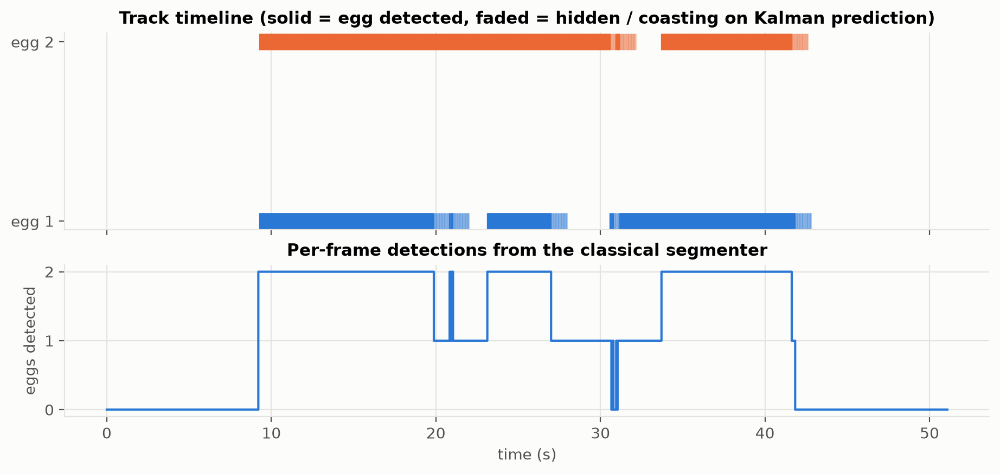
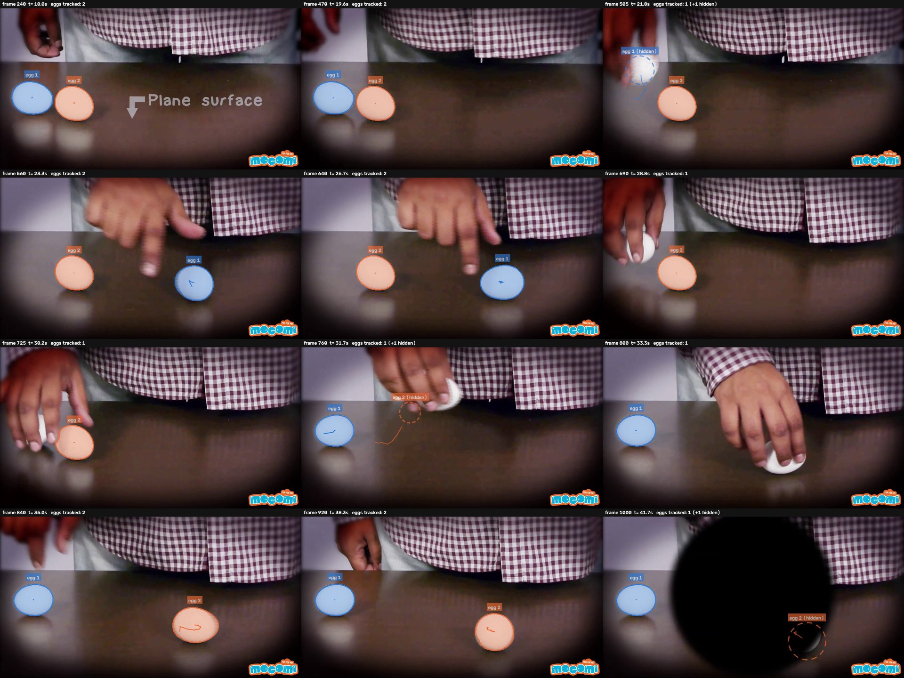

# Task 4 – Video tracking

**Video:** "Raw and Boiled Egg Spinning" (YouTube `Y4JyV94y2_A`), 60 s, 1920×1080, 24 fps, 1440 frames.
0–9 s and 42–60 s are title/text cards (no eggs); 9.2–41.7 s show **two white eggs on a dark glossy table**
that a hand picks up, carries, and spins.

**Pipeline:** `video frame → downscale to 640×360 → classical segmenter (Task 2, adapted) → per-frame egg masks →
SORT-style tracker → rendered video (1280×720, H.264)`.
Run: `python scripts/video_detect.py` (parallel, ~7.5 min on 11 CPU workers) then `python scripts/video_track.py`.

## 1. Adapting the segmenter (`configs/video.json`)

The Task 2 algorithm was kept unchanged; four settings were added (all *off* by default, so dataset results are
reproduced exactly – verified, dev IoU 0.7041). Each was motivated by a failure seen on sample frames:

| change | why | evidence |
|---|---|---|
| size prior `size_mu` −1.03 → −1.65 | dataset eggs are close-ups (median 10% of the image); in this wide shot an egg is ≈2% of the frame | measured egg size in video frames |
| `min_score = 0.15` | the dataset version always keeps ≥1 egg; title cards must give **no** egg (Task 3, improvement #4) | text "presents" was detected on a title card |
| `max_chroma = 20` | the colourful "mocomi" logo was detected as an egg | all 138 dataset eggs have mean Lab chroma ≤ 11.3; logo = 34 |
| `min_lcon = 80` | the egg **reflections** in the glossy table are elliptical and were detected (149 frames with 3 detections) | egg-vs-surround brightness contrast: real eggs 114–168, reflections 43–44 |

## 2. Tracker (`src/eggseg/tracking.py`)

A classical SORT-style multi-object tracker:

1. **Kalman filter** per egg, constant-velocity state (x, y, vx, vy): predicts the egg centre in the next frame.
2. **Association cost** for each (track, detection) pair: `d + (1 − IoU)`, where d = distance between predicted and
   detected centre in egg diameters, IoU = overlap of the track's last mask shifted to the prediction with the
   detection. Pairs with d above a gate (≈1 diameter, growing while a track is unseen) are forbidden.
3. **Hungarian algorithm** (`scipy.optimize.linear_sum_assignment`): globally optimal one-to-one matching.
4. **Track life cycle:** an ID is assigned only after 3 consecutive matches (one-frame false positives never get an
   ID); unmatched tracks **coast** on the Kalman prediction (shown as a dashed circle "hidden").
5. **Re-identification by elimination.** The eggs look identical, so appearance cannot tell them apart, but the scene
   logic can: while the other egg is still being tracked, an egg that re-appears must be the missing one. A track
   unseen for > 1 s may therefore claim a detection anywhere (at a cost always higher than a normal match), and a
   newly confirmed track inherits the ID of a currently missing egg. Lost tracks are kept for 10 s.

## 3. Results

| | value |
|---|---|
| IDs created (ground truth: 2 eggs) | **2** |
| identity errors (12 key frames checked by eye, incl. the hand swapping which egg it holds at 31 s) | **0** |
| false positives on the 655 egg-free frames (title cards) | **0** |
| detection coverage in the egg segment (detected egg-frames / 2 × 778 frames) | **84%** |
| frames with both eggs detected / one / none | 540 / 231 / 7 |
| speed (640×360, 1 CPU core) | ≈ 3.4 s / frame (parallelised over frames: 7.5 min for the video) |

**Iterations (tracking experiment log):**

| version | IDs created | problem | change |
|---|---|---|---|
| v1 dataset settings | – | logo, title-card text, misses due to size prior | video config (size prior, min_score, max_chroma, min_lcon=15) |
| v2 | 7 | reflections detected (149 frames with 3 eggs); 2 s coasting too short for an egg carried in the hand | min_lcon 15 → 80 |
| v3 | 5 | no false positives any more, but an egg carried for 3–7 s comes back with a new ID | re-ID by elimination + ID inheritance, max_age 2 s → 10 s |
| **v4 (final)** | **2** | – | – |

## 4. Limitations

* **Eggs inside the hand are not detected** (the 16% missing coverage): only fragments between the fingers are
  visible, which are not ellipses. The tracker bridges these gaps but does not know *where* the egg is while it is
  carried; the hidden marker is therefore shown for at most 1 s.
* **Re-ID by elimination assumes a fixed number of identical eggs.** With a third egg entering, or two eggs hidden at
  the same time and re-appearing in swapped positions, IDs could be swapped. An appearance model (colour histogram,
  size, spots on the shell) or a hand tracker would be needed there.
* **Speed:** 3.4 s per frame is far from real time. Easy gains: run the full detector only every N frames and in
  between search only near the Kalman prediction (small crop), reuse the previous mask as the watershed marker,
  and drop the "darkness" view (useless on a dark table).
* Spinning eggs are motion-blurred; the masks become slightly larger/rounder, but are still detected.
* No frame-level ground truth exists for the video; segmentation quality on the video was judged visually.
  A natural next step is to run the Task 1 SAM notebook on sampled video frames and compute IoU as in Task 3.
